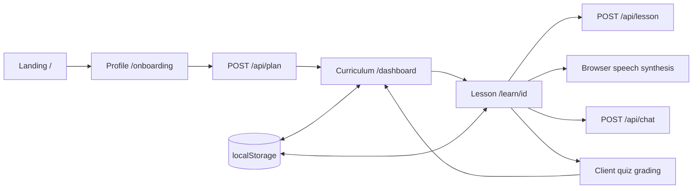

# Architecture

OwnPath Phase 1 is a Next.js App Router application with a small server API surface and browser-owned learning state. TypeScript strict mode is enabled. Tailwind CSS and shared styles provide a responsive cream-and-olive interface. Runtime dependencies are limited to Next.js, React, and React DOM.

## Application flow

| Route         | Responsibility                                                                                             |
| ------------- | ---------------------------------------------------------------------------------------------------------- |
| `/`           | Introduce OwnPath and open onboarding or a sample learning path.                                           |
| `/onboarding` | Collect a typed learner profile and request a plan.                                                        |
| `/dashboard`  | Display the active curriculum, resources, progress, and next available module.                             |
| `/learn/[id]` | Resolve a module in the current plan, load its lesson, narrate slides, answer questions, and grade a quiz. |

Page components compose reusable `ProfileForm`, `CurriculumView`, `LecturePlayer`, `LectureChat`, and `Quiz` components. Shared navigation and layout keep the flow consistent. Client components handle forms, local state, browser storage, speech synthesis, and interactive assessment. Server route handlers contain no browser dependencies.

## Contracts and API boundary

`lib/types.ts` defines domain objects and every request/response contract. `lib/api-client.ts` is the typed browser HTTP boundary. Pure runtime assertions and request parsers live in `lib/validators.ts`; they are shared by server handlers and browser-state restoration without importing server code. `lib/validation.ts` adds bounded JSON transport and HTTP error responses, re-exporting the validators for route handlers. Routes invoke `lib/ai.ts` after validation. The deterministic catalog and mock generators live in `lib/mock-data.ts`.

All future Claude integration belongs behind `lib/ai.ts`. It must preserve the existing response types or coordinate an explicit shared contract change. `ANTHROPIC_API_KEY` remains server-only; the Phase 1 adapter always returns mocks regardless of its presence. Components never import an AI SDK or credentials.

The mock catalog has six modules for each of three tracks: Data Science, Web Development, and Product Design. Profile fields influence the summary and pacing through fixed rules. Lesson IDs and module relationships stay consistent across API calls; the lesson endpoint checks catalog identity rather than generating arbitrary user-supplied course content. Tutor responses use validated slide context.

## Browser state

The learning provider exposes the active profile, plan, cached lessons, quiz results, hydration state, and persistence warning. Its versioned localStorage record is the only persistence layer. Browser APIs are read after client hydration, so server rendering does not assume access to `window`.

Creating a new plan resets the previous lesson cache and quiz progress. Starting an available module marks it in progress. A passing quiz marks its module completed and releases modules whose prerequisites have all been completed. Failed attempts can be retried; the best recorded quiz score and completed status remain intact when a later attempt scores lower. Chat remains local to the lesson interface rather than being synchronized to a server.

State is a prototype convenience, not trusted authorization. LocalStorage and client-visible quiz answers can be modified by the user. On restore, the provider validates the profile, module relationships, cached lessons, and score/count/pass consistency of quiz results. Invalid individual cache entries are discarded and can be regenerated while retaining a valid path. Reloading a lesson uses the cached lesson when available. Missing, unavailable, or unknown module IDs show a recovery path to the curriculum instead of assuming a valid plan.

## Narration and assessment

`LecturePlayer` uses browser speech synthesis for the slide's narration text. It supports manual navigation and playback controls, cancels owned speech as context changes, and offers readable text when audio is unavailable. Voice availability and audio permissions are browser/OS dependent; there is no generated audio or video pipeline.

`Quiz` requires an answer to each question, computes a percentage, shows explanations, and records a pass at 70% or above. Assessment is deliberately local and does not claim proficiency verification. `LectureChat` sends the lesson context and question to the mock tutor endpoint, and presents pending and error states.

## Validation and deployment

Use Node.js 24 or newer. Run `npm run typecheck`, `npm run lint`, and `npm run build` before delivery. The production build uses Next.js's supported Webpack mode because Turbopack's worker-port behavior is restricted in the local sandbox. With a server running, `npm run test:smoke` verifies the four page routes, all three endpoint flows across all tracks, lesson generation for all 18 catalog modules, contract relationships, and malformed/invalid/oversized requests. Browser QA checks the full profile-to-quiz interaction, responsive layouts, and storage behavior. See [local validation results](VALIDATION.md).

Vercel can deploy this as a standard Next.js application. Mock mode requires no credentials or external services. No deployment configuration, authentication service, database, PDF parser, or video generator is introduced in Phase 1.
