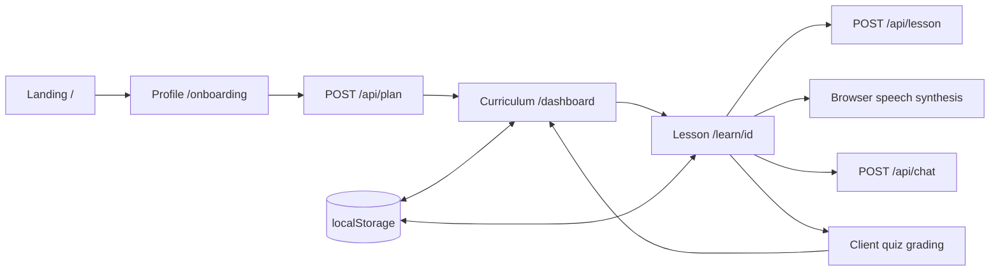

# Architecture

OwnPath Phase 3A integrates the Phase 2A curriculum engine and Phase 2B lecture/tutor system in a Next.js App Router application with a small server API surface and browser-owned learning state. TypeScript strict mode is enabled. Tailwind CSS and shared styles provide a responsive cream-and-olive interface. Runtime dependencies are limited to Next.js, React, and React DOM.

## Application flow

| Route         | Responsibility                                                                                             |
| ------------- | ---------------------------------------------------------------------------------------------------------- |
| `/`           | Introduce OwnPath and open onboarding or a sample learning path.                                           |
| `/onboarding` | Collect a typed learner profile and request a plan.                                                        |
| `/dashboard`  | Display the active curriculum, resources, progress, and next available module.                             |
| `/learn/[id]` | Resolve a module in the current plan, load its lesson, narrate slides, answer questions, and grade a quiz. |

Page components compose reusable `ProfileForm`, `CurriculumView`, `LecturePlayer`, `LectureChat`, and `Quiz` components. Shared navigation and layout keep the flow consistent. Client components handle forms, local state, browser storage, speech synthesis, and interactive assessment. Server route handlers contain no browser dependencies.

## Contracts and API boundary

`lib/types.ts` defines domain objects and every request/response contract. `lib/api-client.ts` is the typed browser HTTP boundary. Pure runtime assertions and request parsers live in `lib/validators.ts`; they are shared by server handlers and browser-state restoration without importing server code. `lib/validation.ts` adds bounded JSON transport and HTTP error responses, re-exporting the validators for route handlers. The plan route uses `lib/ai.ts` to select `lib/claude-plan.ts` or the original mock generator. Lesson and tutor routes use `lib/claude-lesson.ts` and `lib/claude-tutor.ts`; their unconfigured fallback delegates to the existing functions in `lib/ai.ts`. The deterministic catalog and mock generators remain in `lib/mock-data.ts`.

All three endpoints preserve their existing request structures and return the shared `"mock" | "claude"` response mode. Claude adapters use server-only native `fetch`, structured JSON, bounded generation, and runtime output validation. `ANTHROPIC_API_KEY` remains server-only. Missing, blank, or dummy placeholder keys choose mocks; configured keys attempt Claude and fail with safe API errors when invalid or unavailable. Components never import server adapters or credentials.

The mock catalog has six modules for each of three tracks: Data Science, Web Development, and Product Design. Claude curricula contain 4–6 modules whose actual content and difficulty respond to background, experience, skills, specific goals, and weekly study time. Academic resource metadata comes only from the server's verified catalog; selected URLs are checked before returning a live plan. Claude lesson generation accepts any valid plan module and teaches its title, description, and topics without a catalog-ID requirement. Catalog identity checks remain in mock lesson generation. Each live lesson has 4–6 slides and three quiz questions and fits the subsequent tutor payload budget.

## Browser state

The learning provider exposes the active profile, plan, cached lessons, quiz results, hydration state, and persistence warning. Its versioned localStorage record is the only persistence layer. Browser APIs are read after client hydration, so server rendering does not assume access to `window`.

Creating a new plan resets the previous lesson cache and quiz progress. Starting an available module marks it in progress. A passing quiz marks its module completed and releases modules whose prerequisites have all been completed. Failed attempts can be retried; the best recorded quiz score and completed status remain intact when a later attempt scores lower. Chat remains local to the lesson interface rather than being synchronized to a server.

State is a prototype convenience, not trusted authorization. LocalStorage and client-visible quiz answers can be modified by the user. On restore, the provider validates the profile, module relationships, cached lessons, and score/count/pass consistency of quiz results. Invalid individual cache entries are discarded and can be regenerated while retaining a valid path. Reloading a lesson uses the cached lesson when available. Missing, unavailable, or unknown module IDs show a recovery path to the curriculum instead of assuming a valid plan.

## Narration and assessment

`LecturePlayer` defaults to Amanda Multilingual through `/api/narration`. The server uses Azure Speech with server-only credentials and synthesizes one slide at a time. `lib/neural-narration.ts` owns audio loading, playback rate, pause/resume, automatic slide advancement, cancellation, and temporary clip URLs. It caches up to eight clips during the mounted lesson and revokes them when disposed. The server also keeps a bounded ten-minute in-memory cache to avoid repeat synthesis. Missing configuration and synthesis failures remain visible; they never silently select a browser voice. The Voice selector offers browser speech synthesis as an explicit alternative. Transcripts remain available with either source. There is no video renderer.

`Quiz` offers a 5–10 question selector, requires an answer to each generated question, computes a percentage, shows explanations, and records a pass at 70% or above. Generating or retrying calls `/api/quiz` for the selected number of fresh lesson-grounded questions, excluding recent question stems. Changing the selector alone preserves current answers; legacy three-question sets show setup instead of a submittable form. `LessonExperience` owns loading, error, duplicate-request, and cancellation handling. Successful refreshes replace only the cached lesson's quiz and remount the assessment; slides and earlier progress stay intact. Each scored attempt stores a question snapshot, and `lessonForAttempt` resolves that snapshot for accurate reviews after subsequent refreshes. Assessment is deliberately local and does not claim proficiency verification. Correct answers are client-visible in both response modes.

`resourcesForLesson` supplements module resources with fixed official and academic sources ranked against the lesson title, module topics, and slide content. It renders four or five distinct HTTPS readings without changing the saved module, lesson, or progress. Shared sidebar and homepage branding use `ClaudeCredit` for the “Powered by Claude” credit.

Lessons without scene metadata request `/api/lesson/detail` once while retaining the saved teaching. The response adds ordered explanations and concrete visuals; the provider merges teaching separately from quiz state. `LecturePlayer` derives short narration frames from each scene and displays the exact frame text as a caption. Both Amanda audio and browser speech advance through frames, updating the example and visual emphasis before moving to the next slide. The neural controller prefetches one frame, deduplicates requests, and cancels obsolete clips. A content signature resets playback when an expanded lesson arrives without changing its identity. Entrance animations respect reduced-motion preferences; explanation controls support reading without audio.

Lesson expansion and quiz generation are serialized in the player; existing answers can still be submitted while details load. Both parent preflight and atomic state merges enforce a combined lesson/quiz request budget, preserving the current lesson and score when a response would exceed it. Browser speech resumes the global synthesizer before starting a fresh frame after a pause, stop, or navigation.

`LessonExperience` shares the active slide index between player and tutor. `LectureChat` sends the full lecture, current question, and bounded conversation history to `/api/chat`. An optional hidden question prefix identifies the current slide without changing `ChatRequest`; the server validates its membership in the lesson. Prior turns retain their own slide context across navigation. Focusing or submitting the tutor pauses narration without discarding the resumable utterance. The tutor displays the server's actual response mode, pending state, and retryable errors. Cached lessons use a neutral saved-lesson label because response mode is not added to the storage schema.

## Validation and deployment

Use Node.js 24 or newer. Run `npm run typecheck`, `npm run lint`, and `npm run build` before delivery. The production build uses Next.js's supported Webpack mode because Turbopack's worker-port behavior is restricted in the local sandbox. With a server running, `npm run test:smoke` verifies the four page routes, all three endpoint flows across all tracks, lesson generation for all 18 catalog modules, contract relationships, and malformed/invalid/oversized requests. Browser QA checks the full profile-to-quiz interaction, responsive layouts, and storage behavior. See [local validation results](VALIDATION.md).

Vercel can deploy this as a standard Next.js application. Mock mode requires no credentials or external services. Live generation requires server-side Anthropic access and academic-resource connectivity. Phase 3A adds no deployment configuration, authentication service, database, PDF parser, video renderer, voice recognition, or real-time audio streaming.
